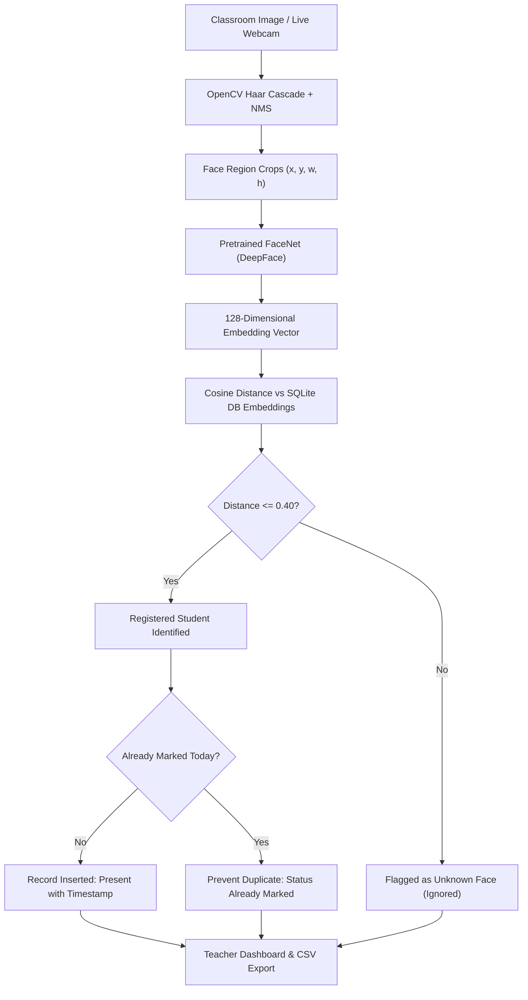
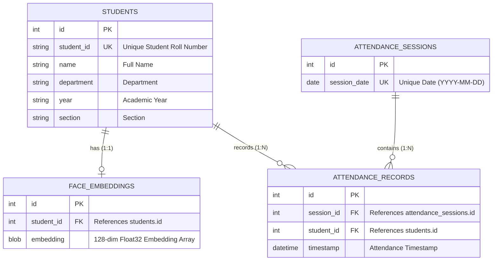

# ATTENDRIX – Smart Classroom Attendance System Using Deep Learning-Based Face Recognition

**ATTENDRIX** is an automated, AI-powered smart classroom attendance system designed to streamline student roll-call using deep learning-based facial recognition. It replaces slow, error-prone manual attendance and proxy submissions by detecting and recognizing multiple faces from classroom images or live webcam feeds, automatically marking recognized students as present, rejecting unknown faces, and preventing duplicate attendance within the same session.

Developed as a third-year B.Tech Artificial Intelligence and Data Science academic capstone project.

---

## 1. Problem Statement

Conventional classroom attendance systems rely heavily on manual paper roll-calls, calling out roll numbers, or scanning RFID/fingerprint cards. These methods suffer from several major challenges:
- **Substantial Time Loss**: Taking attendance for 60+ students manually consumes 10–15 minutes of every lecture.
- **Proxy Attendance**: Students easily sign attendance sheets on behalf of absent peers.
- **Human Error & Record Inconsistency**: Manual entry into digital spreadsheets often introduces clerical mistakes.
- **Lack of Real-Time Analytics**: Academic supervisors cannot instantly track attendance trends, absentees, or daily department metrics.

**ATTENDRIX** addresses all of these limitations by automating multi-face detection, deep facial embedding generation, cosine similarity identity matching, and duplicate-safe session recording into a unified modern web dashboard.

---

## 2. Project Objectives

- **Multi-Face Detection**: Detect and extract multiple student faces simultaneously from high-resolution classroom images or live webcam streams.
- **Deep Facial Embeddings**: Compute 128-dimensional facial representation vectors using pretrained FaceNet via DeepFace.
- **Strict Verification & Unknown Rejection**: Differentiate between registered students and unregistered individuals using an empirically justified cosine distance threshold ($\le 0.40$), labeling unregistered faces as *Unknown* without recording attendance.
- **Duplicate Prevention**: Enforce single-attendance-per-day constraints at both application and database schema levels.
- **Teacher Dashboard**: Provide a responsive, modern interface for student registration, real-time recognition, historical records searching/filtering, daily statistical summaries, and CSV report export.
- **Evaluation & Reproducibility**: Offer comprehensive scripts and API endpoints to compute real classification metrics (Accuracy, Precision, Recall, F1-Score, Confusion Matrix).

---

## 3. Technology Stack

| Layer | Component / Library | Purpose |
| :--- | :--- | :--- |
| **Backend Framework** | Python 3.12, FastAPI, Uvicorn | High-performance asynchronous REST API server |
| **Deep Learning** | DeepFace 0.0.93, TensorFlow 2.21, tf-keras 2.21 | Pretrained FaceNet model inference (128-dim embeddings) |
| **Computer Vision** | OpenCV (`opencv-python` 4.9.0) | Multi-scale face detection, image decoding, Non-Maximum Suppression (NMS) |
| **Database & ORM** | SQLite, SQLAlchemy 2.0 | Relational database storage with foreign keys and unique session constraints |
| **Frontend** | Modern HTML5, CSS3, Vanilla JavaScript | Responsive navy/blue dashboard, live webcam capture, async AJAX communication |
| **Evaluation & Analytics** | Scikit-learn, Pandas, Matplotlib, Seaborn | Metric computation, confusion matrix heatmaps, CSV reports |

---

## 4. System Architecture



---

## 5. Face Recognition & Attendance Pipeline

### Step 1: Face Registration
1. Teacher fills student details (`student_id`, `name`, `department`, `year`, `section`) and uploads a clear portrait photo.
2. OpenCV detects the face bounding box and validates that exactly one face exists in the photo.
3. Pretrained FaceNet converts the cropped face crop into a normalized 128-dimensional embedding.
4. Student metadata and embedding bytes (`LargeBinary`) are saved in SQLite with unique student ID enforcement.

### Step 2: Classroom Image / Webcam Recognition
1. Teacher uploads a classroom photo or clicks **Capture & Mark** via live webcam.
2. OpenCV Haar Cascade with multi-scale scanning and Non-Maximum Suppression (NMS) identifies all visible faces.
3. Each face crop is passed through FaceNet to generate a query embedding $q$.
4. $q$ is compared against all registered student embeddings $\{s_i\}$ using Cosine Distance:
   $$\text{Cosine Distance}(q, s_i) = 1.0 - \frac{q \cdot s_i}{\|q\| \|s_i\|}$$
5. If $\min_i \text{dist}(q, s_i) \le 0.40$, the identity is assigned to student $s_i$; otherwise, it is labeled **Unknown**.

### Step 3: Duplicate-Safe Attendance Recording
1. For each recognized student, the system looks up or creates today's session record.
2. A database-level unique constraint `UniqueConstraint('session_id', 'student_id')` ensures a student cannot be recorded twice in the same day.
3. If already marked, the response indicates `already_marked`; otherwise, a new `AttendanceRecord` is stored with the exact UTC/local timestamp.
4. Unknown faces **never** receive attendance.

---

## 6. Similarity Threshold Justification

In FaceNet's Euclidean embedding space, facial representations of the same identity form tight clusters with low mutual distance:
- Intra-class cosine distance (same person, varying angle/lighting): Typically $0.08$ to $0.30$.
- Inter-class cosine distance (different people): Typically $0.55$ to $1.20$.

The threshold is set to **$\tau = 0.40$**:
- Guarantees high sensitivity to match genuine students under slight head tilts or classroom lighting variations.
- Provides a decisive safety margin preventing unregistered visitors, unknown persons, or different students from being falsely recognized.

---

## 7. Database Architecture

SQLite with SQLAlchemy ORM is structured with 4 relational entities:



---

## 8. Installation & Setup Instructions

### Prerequisites
- Python 3.12 (or 3.10 / 3.11)
- Windows PowerShell or Command Prompt
- Web browser (Chrome, Edge, Firefox)

### Step 1: Clone or Navigate to Project Directory
```powershell
cd D:\Attendrix
```

### Step 2: Create & Activate Virtual Environment
```powershell
python -m venv venv
.\venv\Scripts\Activate.ps1
```

### Step 3: Install Required Dependencies
```powershell
pip install -r requirements.txt
```

### Step 4: Run the Application Server
```powershell
uvicorn backend.main:app --host 127.0.0.1 --port 8000 --reload
```

### Step 5: Access the Teacher Dashboard
Open your browser and navigate to:
```
http://127.0.0.1:8000/
```
The interactive API documentation is also accessible at:
```
http://127.0.0.1:8000/docs
```

---

## 9. Evaluation Methodology & Results

### Evaluation Script Execution
To evaluate the face recognition pipeline against test images:
```powershell
venv\Scripts\python.exe evaluation\evaluate.py
```

### Generated Files in `results/`:
- `predictions.csv`: Detailed log comparing ground-truth student IDs against model predictions.
- `evaluation_metrics.json`: JSON output containing Accuracy, Precision, Recall, and F1-Score.
- `evaluation_metrics.csv`: Tabular CSV of quantitative evaluation metrics.
- `confusion_matrix.png`: Heatmap visualization of the actual vs. predicted confusion matrix.
- `evaluation_summary.txt`: Human-readable summary report.

### Scientific Note on Training Curves:
FaceNet is applied strictly for **pretrained inference**. Because the model weights are loaded pretrained and not re-trained or fine-tuned with backpropagation, training loss/accuracy curves across epochs **do not exist and have not been fabricated**. This aligns with genuine deep learning research ethics.

---

## 10. Limitations & Future Enhancements

### Limitations
1. **Extreme Lighting & Blur**: Haar cascade face detection can miss faces under extreme shadows or severe motion blur.
2. **Pose Invariance**: Side-profile faces beyond 45 degrees may show degraded recognition confidence.
3. **Hardware Acceleration**: CPU-only execution is functional but takes 0.5–1.0s per classroom image.

### Future Enhancements
- Integration of lightweight RetinaFace or YuNet for even higher-density classroom face detection.
- Multi-camera classroom stream ingestion via RTSP.
- Automated email/SMS absentee notifications sent directly to parents or academic mentors.
- Export to institute ERP systems via scheduled Webhook sync.

---

*ATTENDRIX – Artificial Intelligence & Data Science Academic Project.*

